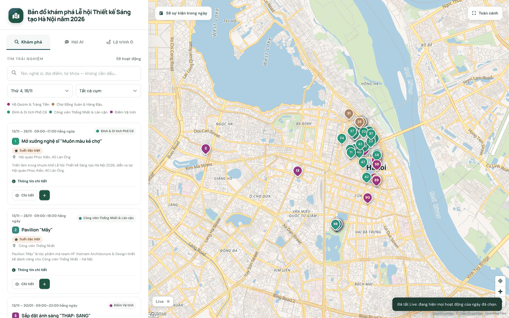
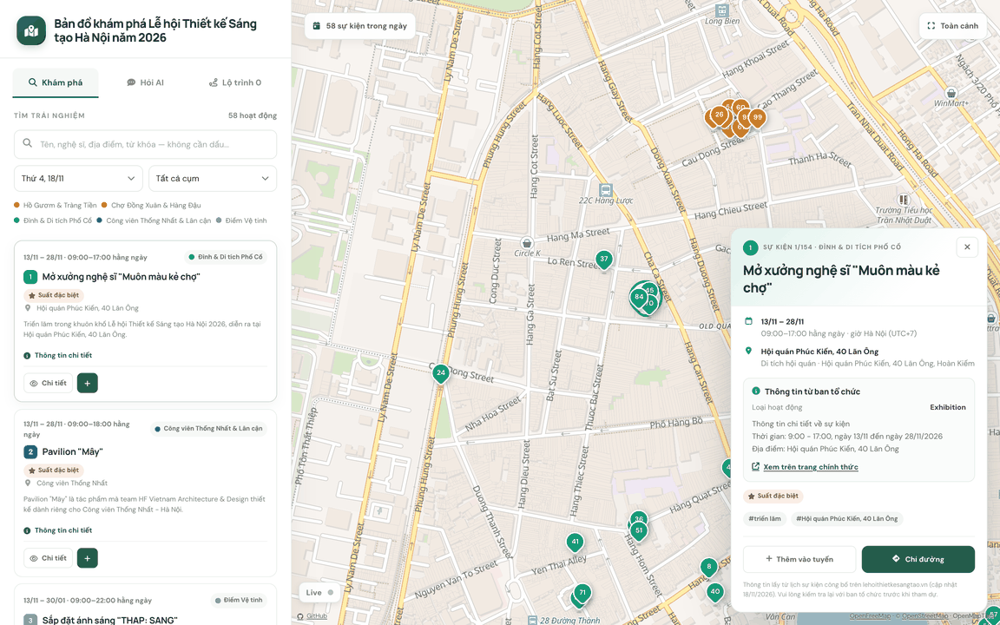
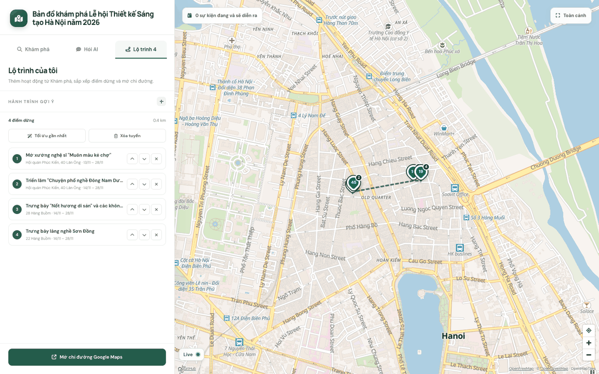
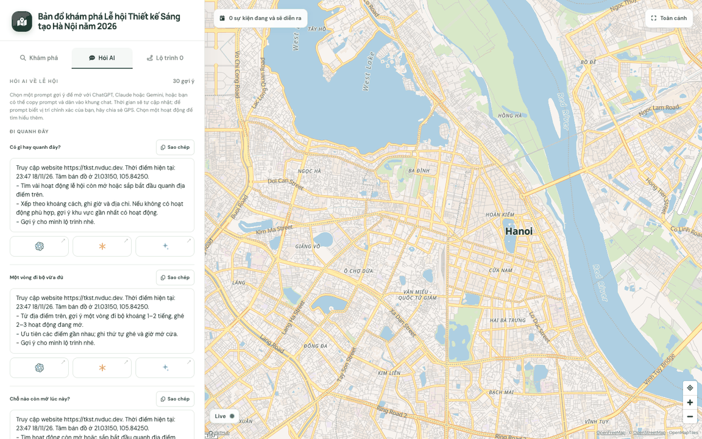

# Bản đồ Lễ hội Thiết kế Sáng tạo Hà Nội 2026

Bản đồ tổng hợp các hoạt động thuộc **Lễ hội Thiết kế Sáng tạo Hà Nội 2026** (13–28/11/2026), giúp bạn dễ dàng tìm kiếm địa điểm, khám phá các chương trình và lên lịch trình tham quan.

Đây là dự án cá nhân mình thực hiện với mong muốn việc tiếp cận thông tin và khám phá lễ hội trở nên thuận tiện hơn.

## Về dự án

Lễ hội có rất nhiều hoạt động diễn ra tại các địa điểm khác nhau trong thành phố. Thay vì phải tìm kiếm và đối chiếu thông tin từ nhiều nguồn, bản đồ cung cấp một góc nhìn tổng quan về các hoạt động và không gian tổ chức, giúp việc khám phá trở nên trực quan và thuận tiện hơn.

Bạn có thể sử dụng bản đồ để tìm kiếm hoạt động theo sở thích, khám phá các địa điểm xung quanh, theo dõi lịch tổ chức hoặc kết hợp nhiều điểm đến thành một hành trình riêng. Một số lộ trình gợi ý và câu hỏi dành cho các công cụ AI cũng được xây dựng để hỗ trợ quá trình tìm hiểu và lên kế hoạch.

## Tính năng chính

Trang mở ra ở tab Khám phá. Bên trái là danh sách hoạt động với ô tìm kiếm, bộ lọc ngày và bộ lọc cụm; bên phải là bản đồ. Mỗi cụm có một màu pin riêng nên nhìn màu là đoán được khu vực. Mỗi thẻ có ảnh bìa lấy từ ảnh do ban tổ chức công bố, còn lại là poster theo loại hình của hoạt động. Chế độ Live bật sẵn và chỉ giữ những hoạt động còn mở trong ngày, con số trên thanh trên cùng cho biết đang có bao nhiêu hoạt động như vậy.

Bấm vào một pin hoặc một thẻ trong danh sách sẽ mở bảng chi tiết: địa chỉ, khung giờ, loại hình, phần giới thiệu của ban tổ chức và đường dẫn tới trang gốc. Từ bảng này có thể thêm hoạt động vào lộ trình hoặc mở chỉ đường.

Trong bảng chi tiết cũng có nút đánh dấu địa điểm đã ghé. Danh sách này chỉ lưu trong trình duyệt của bạn: lần sau mở lại, pin của những địa điểm đó chuyển sang màu xám, và nút "Đã ghé" cạnh Live hiện lại đầy đủ màu khi cần. Việc làm mờ chỉ là lớp hiển thị, không ảnh hưởng bộ lọc ngày, bộ lọc cụm hay chế độ Lân Cận.

Tab Lộ trình giữ những điểm đã chọn và sắp xếp lại theo khoảng cách từ điểm xuất phát. Mỗi chặng có khoảng cách ước tính, và nút ở cuối đưa cả hành trình sang Google Maps. Đường nối giữa các điểm cũng được vẽ trên bản đồ.

Tab Hỏi AI gom sẵn vài câu hỏi thường gặp về lịch, địa điểm và cách đi lại. Mỗi câu có nút mở thẳng trong ChatGPT, Claude hoặc Gemini với nội dung đã điền sẵn, thêm nút sao chép cho trường hợp muốn dán vào ứng dụng khác.

## Nguồn dữ liệu

Thông tin về hoạt động, thời gian, địa điểm và mô tả được tổng hợp từ website chính thức của ban tổ chức:

[lehoithietkesangtao.vn](https://lehoithietkesangtao.vn)

Ảnh sự kiện do ban tổ chức công bố trên website, các album ảnh và các kênh Facebook, Instagram, đã được thu nhỏ cho nhẹ trang. Những chương trình có thiệp giới thiệu riêng của ban tổ chức thì dùng chính thiệp đó làm ảnh bìa. Mỗi hoạt động có thể có nhiều ảnh: bảng chi tiết hiện ảnh bìa kèm dải ảnh nhỏ, vuốt ngang hoặc bấm vào ảnh để xem các ảnh còn lại, và mở được chế độ xem toàn màn hình (vuốt, phím mũi tên). Ảnh có chữ của ban tổ chức — thiệp chương trình, poster có giờ và địa điểm — được ưu tiên làm ảnh bìa. Những hoạt động chưa có ảnh dùng poster do trang tự tạo theo loại hình.

Nền bản đồ sử dụng [OpenFreeMap](https://openfreemap.org), với dữ liệu bản đồ © [OpenStreetMap contributors](https://www.openstreetmap.org/copyright).

---

Đây là dự án cá nhân, được phát triển độc lập và không phải website chính thức của Lễ hội Thiết kế Sáng tạo Hà Nội 2026.

## Giấy phép

Mã nguồn phát hành theo giấy phép [MIT](LICENSE).
